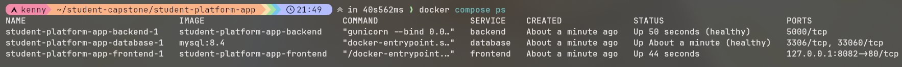
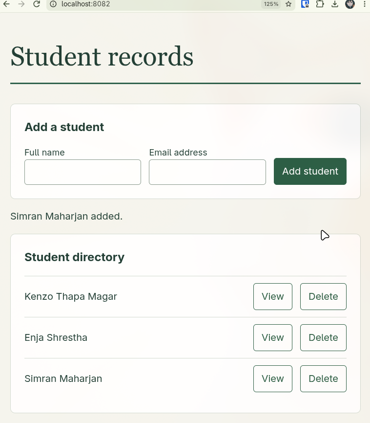
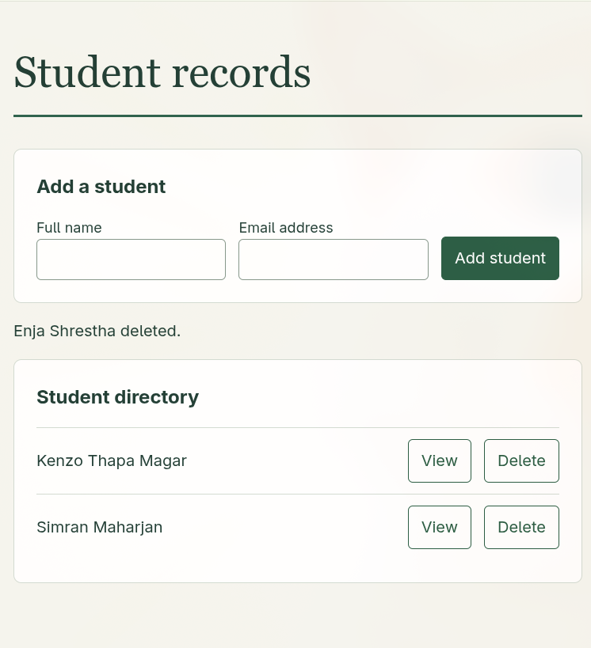

# Student Management Platform

A small three-tier app run with Docker Compose: an Nginx frontend, a Flask backend, and a MySQL database.

## Run locally

From the project directory:

1. Copy `.env.example` to `.env`.
2. Fill in two **different** local database passwords (`DB_PASSWORD` and `DB_ROOT_PASSWORD`). Hex strings generated by `openssl rand -hex 24` work well.
3. Keep `.env` private and never commit it.

Then run:

```bash
docker compose config --quiet
docker compose up -d --build --wait
docker compose ps
curl -fsS http://localhost:8082/readyz
```

Open <http://localhost:8082>.

If that port is occupied, change `FRONTEND_PORT` in `.env` and use the new port in your URL.

## Day 1 demonstration

1. Add two fictional students.
2. List both students.
3. Use **View** to retrieve one by ID.
4. Delete the other student.
5. Run `docker compose down`, then `docker compose up -d --wait`.
6. Refresh the page and check that the surviving record is still there.

Keep the named volume for this test (do not use `down -v`). Save screenshots in `docs/screenshots/`.

## Request flow

```
Browser -> Nginx (frontend) -> Flask (backend:5000) -> MySQL (database:3306)
```

- Nginx serves the frontend and forwards `/api/` to `backend:5000`.
- Flask connects to `database:3306`.
- Compose DNS resolves the service names.
- Only Nginx publishes a host port.
- MySQL runs `database/init.sql` when it initializes an empty data volume.

## API

| Method   | Endpoint             | Description                                                                                   |
| -------- | -------------------- | --------------------------------------------------------------------------------------------- |
| `GET`    | `/api/students`      | List all records                                                                              |
| `POST`   | `/api/students`      | Create a record. Accepts a JSON object with `name` and `email` and returns the created record |
| `GET`    | `/api/students/<id>` | Retrieve one record                                                                           |
| `DELETE` | `/api/students/<id>` | Delete one record                                                                             |
| `GET`    | `/readyz`            | Check the database connection and the `students` table                                        |

## Troubleshooting

Check container state and recent logs:

```bash
docker compose ps -a
docker compose logs --tail=60 database backend frontend
```

Database credentials are initialized on first startup. If you change `.env` later, update the database account credentials too.

## Day 1 verification

I started the student management platform locally with Docker Compose and confirmed that the Nginx frontend, Flask backend, and MySQL database were running. From the browser, I added two sample students, listed both records, opened one student's details by ID, and deleted the other student.

**Running containers and port mapping**



**Student list and individual record details**



I recreated the containers with the named MySQL volume retained. After refreshing the browser, I confirmed that the remaining student was still listed and the deleted record stayed absent.

**Student directory after restart**



## Day 2 verification — Continuous integration

[PR #1](https://github.com/sujanpakhrin/student-platform-app/pull/1) added a GitHub Actions workflow that builds the frontend and backend images, starts the three-tier application with Docker Compose, and tests student creation, listing, lookup, and deletion.

After the merge to `main`, the [successful publishing run](https://github.com/sujanpakhrin/student-platform-app/actions/runs/44477859858/job/135402652672) tested the application again and pushed both tested images to Docker Hub with the tag `sha-4368a0d5f7701be833b04fdf62abcf7942c8c92f`.

| Evidence                                                       | What it shows                                             |
| -------------------------------------------------------------- | --------------------------------------------------------- |
| [Pull request checks](docs/screenshots/04-pr-checks.png)       | The build and API tests passed before merge.              |
| [Publishing run on main](docs/screenshots/05-main-publish.png) | GitHub Actions pushed both tested images.                 |
| [Frontend image tag](docs/screenshots/06-frontend-tag.png)     | The frontend repository contains the commit-tagged image. |
| [Backend image tag](docs/screenshots/07-backend-tag.png)       | The backend repository contains the matching commit tag.  |
